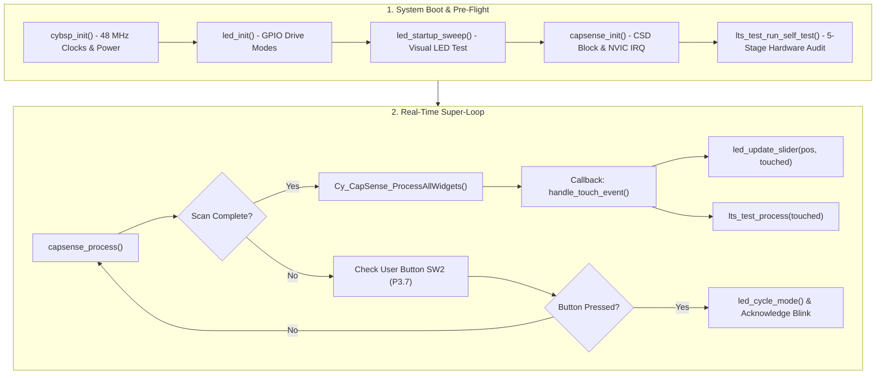
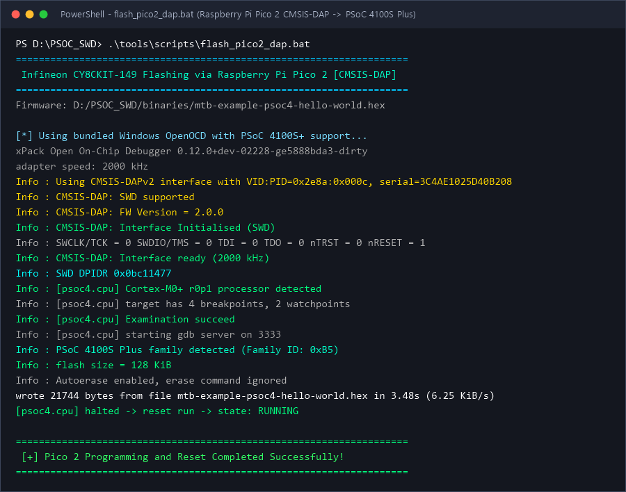
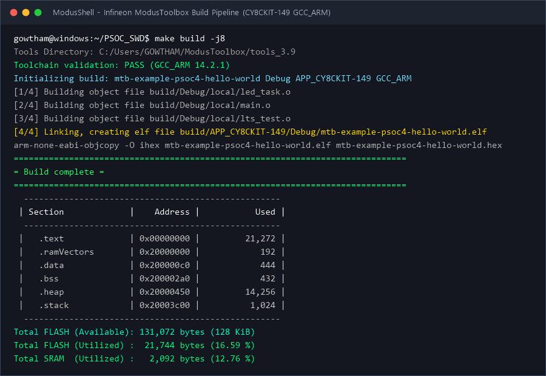

# CY8CKIT-149: PSoC™ 4100S Plus CAPSENSE™ Multi-Mode Touch Slider with External SWD Programming

[](LICENSE)
[](WINDOWS_SETUP.md)
[](https://www.infineon.com/psoc4)
[](https://www.infineon.com/CY8CKIT-149)
[](https://www.infineon.com/modustoolbox)
[](https://github.com/raspberrypi/debugprobe)
[](RP2350_ARCHITECTURE.md)

Production-grade Infineon ModusToolbox™ code example demonstrating hardware-accelerated **CAPSENSE™ 5-segment linear slider sensing with a multi-mode LED visual engine**, integrated **Long-Term Stability (LTS) self-test diagnostics**, and an open-source **external SWD flashing pipeline using either a Raspberry Pi Pico 2 (CMSIS-DAP v2) or an ST-LINK V2 clone**.

> [!TIP]
> * **Windows Developers**: For driver installation (WinUSB / Zadig), detailed device manager checklists, and one-click batch scripts, refer to the **[Windows Setup & Flashing Guide (WINDOWS_SETUP.md)](WINDOWS_SETUP.md)**.
> * **Hardware Architecture Deep-Dive**: For an in-depth analysis of the RP2350/RP2354 silicon architecture, PIO-driven SWD timing generation, and CMSIS-DAP v2 bulk transport, refer to the **[RP2350 Technical Whitepaper (RP2350_ARCHITECTURE.md)](RP2350_ARCHITECTURE.md)**.

---

## Table of Contents
1. [Overview](#overview)
2. [Key Features](#key-features)
3. [Quick Start: Clone & 60-Second Flash](#quick-start-clone--60-second-flash)
4. [Hardware Configuration & Wiring](#hardware-configuration--wiring)
   - [Onboard Switch Settings](#onboard-switch-settings)
   - [Programmer Option A: Raspberry Pi Pico 2 (CMSIS-DAP v2) [Recommended]](#programmer-option-a-raspberry-pi-pico-2-cmsis-dap-v2-recommended)
   - [Programmer Option B: ST-LINK V2 Clone](#programmer-option-b-st-link-v2-clone)
5. [Firmware Architecture](#firmware-architecture)
6. [Interactive Operating Modes Tutorial](#interactive-operating-modes-tutorial)
7. [Long-Term Stability (LTS) & Automated Self-Test](#long-term-stability-lts--automated-self-test)
8. [Engineering Insights: External SWD on PSoC™ 4100S Plus](#engineering-insights-external-swd-on-psoc-4100s-plus)
9. [RP2350 Probe Architecture & Working Principles (Whitepaper)](RP2350_ARCHITECTURE.md)
10. [Build & Programming Commands](#build--programming-commands)
11. [Terminal Verification Screenshots](#terminal-verification-screenshots)
12. [References & Related Documents](#references--related-documents)
11. [References & Related Documents](#references--related-documents)

---

## Overview

The **CY8CKIT-149 PSoC™ 4100S Plus Prototyping Kit** is an evaluation platform featuring the **CY8C4147AZI-S475** microcontroller (ARM® Cortex®-M0+ running up to 48 MHz, 128 KB Flash, 16 KB SRAM) and a high-performance **CAPSENSE™ CSD v2** capacitive sensing block.

While official kit workflows rely on the onboard KitProg programmer over Micro-USB, engineering workflows often require external hardware debug probes. This repository provides:
* A modular, MISRA-compliant ModusToolbox™ application implementing a dynamic 3-mode CAPSENSE™ slider.
* An automated on-target Long-Term Stability (LTS) diagnostic suite.
* Complete OpenOCD scripts, patches, and pre-compiled Windows binaries enabling **direct SWD programming via low-cost external adapters** (Raspberry Pi Pico 2 or ST-LINK V2 clones).

---

## Key Features

* **CAPSENSE™ CSD v2 Hardware Sensing**: Non-blocking autonomous widget scanning, baseline tracking, and centroid calculation (0–100 coordinate resolution).
* **3-Mode Visual Engine**:
  * *Mode 0 (Bargraph Fill)*: Solid bar illuminating LEDs proportionally to finger coordinate.
  * *Mode 1 (Precision Dot Tracker)*: Single-cursor beacon tracking fingertip position.
  * *Mode 2 (Knight Rider Wave Scanner)*: Autonomous bounce wave whose speed is modulated by touch position.
* **Onboard Mode Switcher**: Mechanical User Switch (`SW2`, Pin `P3.7`) switches display modes in real time with software debounce and visual LED pulse confirmation.
* **Long-Term Stability (LTS) Diagnostics**: 5-stage pre-flight hardware self-test (RAM, Core Clock, GPIO, Sensor Baseline Sanity, Centroid Math) plus continuous baseline drift and noise monitoring.
* **Turnkey SWD Toolchain**: Pre-configured for Raspberry Pi Pico 2 (CMSIS-DAP v2) and ST-LINK V2 with pre-patched OpenOCD binaries supporting PSoC™ 4100S Plus Family ID `0xB5`.

---

## Quick Start: Clone & 60-Second Flash

### Step 1: Clone the Repository
Clone the repository recursively to ensure all scripts and sub-assets are downloaded:

```bash
git clone https://github.com/gowthamnow/PSOC_SWD.git
cd PSOC_SWD
```

### Step 2: Configure Hardware Switches
On the CY8CKIT-149 board:
1. Set slide switch **SW4** to the **PSoC** position (routes debug signals to `U2` PSoC™ 4100S Plus).
2. Set slide switch **SW1** to **Regulated** mode.

### Step 3: Connect 4 Wires
Connect your programmer (Raspberry Pi Pico 2 or ST-LINK V2) to the 10-pin debug header (**J4**) on the CY8CKIT-149 board:

```text
Programmer SWCLK  ------>  CY8CKIT-149 J4 Pin 4 (SWDCLK)
Programmer SWDIO  <----->  CY8CKIT-149 J4 Pin 3 (SWDIO)
Programmer GND    ------>  CY8CKIT-149 J4 Pin 2 (GND)
Programmer 3.3V   ------>  CY8CKIT-149 J4 Pin 1 (VTARG / VDD)
```

> [!CAUTION]
> **Do NOT plug in the CY8CKIT-149 Micro-USB cable (`J8`)** while powering via the programmer's 3.3V pin to avoid conflicting power rails.

### Step 4: Flash Firmware (One-Click)

#### On Windows (Using Raspberry Pi Pico 2):
Double-click or run from Command Prompt / PowerShell:
```cmd
tools\scripts\flash_pico2_dap.bat
```

#### On Windows (Using ST-LINK V2):
```cmd
tools\scripts\flash_stlink.bat
```

#### On Linux / macOS / WSL:
```bash
chmod +x tools/scripts/flash_pico2_dap.sh
./tools/scripts/flash_pico2_dap.sh
```

---

## Hardware Configuration & Wiring

### Onboard Switch Settings

```text
+--------------------------------------------------------------+
|                    CY8CKIT-149 PROTOTYPING KIT               |
|                                                              |
|   [ SW4 - Debug Mux ]                                        |
|   +---------------+                                          |
|   | BLE | PSoC 4  |  <--- Set slide switch to **PSoC**       |
|   +---------------+                                          |
|                                                              |
|   [ SW1 - Power Reg ]                                        |
|   +---------------+                                          |
|   | Reg | Bypass  |  <--- Set slide switch to **Regulated**  |
|   +---------------+                                          |
+--------------------------------------------------------------+
```

---

### Programmer Option A: Raspberry Pi Pico 2 (CMSIS-DAP v2) [Recommended]

The **Raspberry Pi Pico 2 (RP2350)** running official Debugprobe firmware acts as a high-speed **CMSIS-DAP v2 probe** and USB-to-UART bridge. It uses native Microsoft WinUSB drivers on Windows 10/11 with zero third-party driver installations.

```text
   Raspberry Pi Pico 2 (RP2350)                 CY8CKIT-149 J4 Header
   +----------------------------+                    +---------+
   | (Pin 4)  GP2 [SWCLK]       |------------------> |  Pin 4  | SWDCLK
   | (Pin 5)  GP3 [SWDIO]       |<-----------------> |  Pin 3  | SWDIO
   | (Pin 38) GND               |------------------> |  Pin 2  | GND
   | (Pin 36) 3V3(OUT) [Power]  |------------------> |  Pin 1  | VTARG (3.3V)
   |                            |                    |         |
   | (Pin 6)  GP4 [UART1_TX]    |---> (Optional Target UART_RX)
   | (Pin 7)  GP5 [UART1_RX]    |<--- (Optional Target UART_TX -> COMx)
   +----------------------------+                    +---------+
```

#### Pin Mapping Table

| Pico 2 Pin | Physical Pin | Target Signal | CY8CKIT-149 J4 Pin | Description |
| :--- | :--- | :--- | :--- | :--- |
| **GP2** | **Pin 4** | `SWDCLK` | **Pin 4** | SWD Clock Line |
| **GP3** | **Pin 5** | `SWDIO` | **Pin 3** | SWD Data Input / Output |
| **GND** | **Pin 38 or Pin 3** | `GND` | **Pin 2** | Common Ground |
| **3V3(OUT)** | **Pin 36** | `VTARG` | **Pin 1** | Target 3.3V VDD Supply |
| *GP4* | *Pin 6* | *UART_RX* | *Optional* | Probe to Target Serial TX |
| *GP5* | *Pin 7* | *UART_TX* | *Optional* | Target Serial Log output (viewable on `COMx`) |

> [!TIP]
> If your Pico 2 is in factory BOOTSEL mode, simply drag and drop [`tools/debugprobe_on_pico2.uf2`](tools/debugprobe_on_pico2.uf2) to the `RP2350` drive. It will instantly reboot as a CMSIS-DAP v2 probe.

---

### Programmer Option B: ST-LINK V2 Clone

```text
    ST-LINK V2 Clone (Pinout)               CY8CKIT-149 J4 Header
       +-----------------+                       +---------+
 RST   | 10           9  | SWIM            Pin 1 | [o] [o] | Pin 2  (GND)
 GND   |  8           7  | GND             Pin 3 | [o] [o] | Pin 4  (SWDCLK)
 SWIM  |  6           5  | 3.3V            Pin 5 | [o] [o] | Pin 6
 SWDIO |  4           3  | 3.3V            Pin 7 | [o] [o] | Pin 8
 SWCLK |  2           1  | 5.0V            Pin 9 | [o] [o] | Pin 10
       +-----------------+                       +---------+
```

| ST-LINK V2 Pin | ST-LINK Signal | CY8CKIT-149 J4 Pin | Signal Name | Requirement |
| :--- | :--- | :--- | :--- | :--- |
| **Pin 2** | `SWCLK` | **Pin 4** | `SWDCLK` | Connected |
| **Pin 4** | `SWDIO` | **Pin 3** | `SWDIO` | Connected |
| **Pin 6 or 8** | `GND` | **Pin 2** | `GND` | Connected |
| **Pin 3 or 5** | `3.3V` | **Pin 1** | `VTARG / VDD` | Connected |
| **Pin 10** | `RST` | **Pin 10** | `XRES` | **MUST REMAIN DISCONNECTED!** |

> [!CRITICAL]
> **Why the ST-LINK clone RST wire must be disconnected**:  
> Generic ST-LINK V2 clone dongles tie the `RST` pin to an internal STM8 SWIM pull-down circuit. When connected to the PSoC™ `XRES` pin, the clone clamps `XRES` permanently to 0V. On PSoC™ 4 silicon, holding `XRES` at 0V disables the internal SWD debug multiplexer. Leaving `RST` disconnected allows the MCU to boot cleanly; OpenOCD resets the core using Cortex®-M0+ `AIRCR.SYSRESETREQ`.

---

## Firmware Architecture

The firmware follows official Infineon ModusToolbox™ software architecture standards, cleanly separating peripheral drivers, sensing algorithms, application logic, and hardware diagnostics:

```text
PSOC_SWD/
├── main.c              # Application entry point, BSP initialization, and event loop
├── capsense_task.h/c   # CAPSENSE™ CSD v2 initialization, ISR, scanning, centroid calculation
├── led_task.h/c        # 3-Mode visual engine, GPIO drive modes, sweep animations, bargraph
├── lts_test.h/c        # Long-Term Stability diagnostics suite & 5-stage pre-flight test
├── bsps/               # Official Infineon CY8CKIT-149 Board Support Package & Device Configurator
├── binaries/           # Pre-compiled Intel HEX and ELF binaries (21.7 KB Flash / 2.0 KB SRAM)
├── images/             # Verification terminal captures and architecture diagrams
└── tools/              # Pre-patched Windows OpenOCD, target configs, and flashing scripts
```



---

## Interactive Operating Modes Tutorial

The application features three distinct display modes selectable in real time using the onboard tactile push-button:

### Mode 0: Proportional Bargraph Fill
* **Behavior**: As your finger moves from left to right across the 5-segment slider, LEDs light up sequentially as a solid progress bar.
* **Segment Thresholds**:
  * Position $0 - 19$: LED 5 (`P1.0`)
  * Position $20 - 39$: LED 5 + LED 6 (`P1.2`)
  * Position $40 - 59$: LED 5 + LED 6 + LED 7 (`P1.4`)
  * Position $60 - 79$: LED 5 + LED 6 + LED 7 + LED 8 (`P1.6`)
  * Position $80 - 100$: All 5 LEDs (`P1.0`, `P1.2`, `P1.4`, `P1.6`, `P2.0`)

### Mode 1: Precision Dot Tracker
* **Behavior**: Only a **single green LED** illuminates, acting as a focused cursor that pinpoints the exact centroid of your finger.
* **Use Case**: Analog parameter tuning, volume sliders, or precise selection menus.

### Mode 2: Knight Rider Wave Scanner
* **Behavior**: 
  * *When untouched*: The 5 slider LEDs continuously cycle back and forth in a smooth, rhythmic wave animation.
  * *When touched*: The wave animation accelerates or decelerates proportionally to your finger's position (touching higher accelerates the scan speed).

### How to Switch Modes (User Button Tutorial)
1. Locate the tactile switch **SW2** on the CY8CKIT-149 board (connected to pin `P3.7`).
2. Press **SW2** once:
   * The active mode advances ($0 \rightarrow 1 \rightarrow 2 \rightarrow 0$).
   * The blue User LED (`P3.4`) emits an acknowledgment flash sequence ($1\times$ for Mode 0, $2\times$ for Mode 1, $3\times$ for Mode 2).
3. Slide your finger across the slider to experience the newly active visual mode.

---

## Long-Term Stability (LTS) & Automated Self-Test

The included `lts_test` module provides automotive-style reliability verification:

### Automated 5-Stage Pre-Flight Self-Test
Executed on every boot prior to entering the main event loop:
1. **SRAM Integrity Test**: Verifies RAM memory cells using alternating checkerboard test vectors (`0x55AA55AA` / `0xAA55AA55`).
2. **System Core Timing Verification**: Confirms `SystemCoreClock` matches the configured 48 MHz IMO frequency.
3. **GPIO Port State Validation**: Exercises output drive modes without triggering bus faults.
4. **Sensor Baseline Sanity Check**: Validates that raw counts and baseline parameters for all 5 slider sensors (`SNS0` to `SNS4`) are initialized within nominal boundaries ($100 \le \text{baseline} \le 65,000$).
5. **Centroid Math Bounds**: Validates boundary calculations at 0, 20, 50, 80, and 100.

### Runtime Health Monitoring
* **Baseline Drift Tracker**: Continuously checks that sensor baselines stay within environmental drift thresholds (`LTS_DRIFT_THRESHOLD_COUNTS`).
* **Noise Floor Analyzer**: Evaluates peak-to-peak raw count jitter when the slider is untouched to detect high EMI conditions.
* **System Heartbeat**: When the slider is idle, the blue User LED (`P3.4`) emits a subtle, rhythmic dual-blink heartbeat every 1.5 seconds, providing immediate visual confirmation that the MCU is healthy and scanning.

---

## Engineering Insights: External SWD on PSoC™ 4100S Plus

When interfacing external programmers (OpenOCD, CMSIS-DAP, ST-LINK) with the PSoC™ 4100S Plus family, two critical silicon specifications must be accommodated:

### 1. ARM® Cortex®-M0+ DPIDR Identity
Standard PSoC™ 4 / PRoC™ BLE devices use the ARM® Cortex®-M0 core with DPIDR `0x0bb11477`. The PSoC™ 4100S Plus family uses the ARM® **Cortex®-M0+** core with DPIDR **`0x0bc11477`**. OpenOCD requires setting the DAP TAPID before sourcing the target script:
```tcl
set CPUTAPID 0x0bc11477
source [find target/psoc4.cfg]
```

### 2. PSoC™ 4100S Plus ROM Table Family ID (`0xB5`)
Upstream OpenOCD 0.12.0 `psoc4.c` lookup table stops at PSoC™ 4100S (`0xAB`), omitting the PSoC™ 4100S Plus (`0xB5`). This causes upstream builds to abort with `Error: Cannot identify PSoC 4 family.`

This repository provides:
* Patch file: [`tools/patches/openocd_psoc4100sp_family.patch`](tools/patches/openocd_psoc4100sp_family.patch)
* Pre-patched, zero-install Windows binary: [`tools/openocd_win/`](tools/openocd_win/)
* Target configuration: [`tools/openocd/target/psoc4100sp.cfg`](tools/openocd/target/psoc4100sp.cfg)

---

## Build & Programming Commands

### ModusShell CLI (Windows / Linux)
Open ModusShell, navigate to the repository directory, and run:

| Command | Purpose |
| :--- | :--- |
| `make build -j8` | Compiles application using ModusToolbox™ GCC ARM toolchain into `.elf` and `.hex` |
| `make clean` | Removes build directories and temporary files |
| `make flash-pico2` | **Flashes target via Raspberry Pi Pico 2 (CMSIS-DAP v2)** and issues software reset |
| `make probe-pico2` | Verifies target voltage, CPU registers, and 128 KiB flash geometry via Pico 2 |
| `make reset-pico2` | Issues Cortex®-M0+ software reset (`AIRCR.SYSRESETREQ`) via Pico 2 |
| `make flash-stlink` | **Flashes target via ST-LINK V2 clone** and issues software reset |
| `make probe-stlink` | Probes target state and flash geometry via ST-LINK V2 |
| `make reset-stlink` | Issues software reset via ST-LINK V2 |

### Standalone Command Prompt / PowerShell (Zero Toolchain Install)
```cmd
# Flash using Raspberry Pi Pico 2
tools\scripts\flash_pico2_dap.bat

# Flash using ST-LINK V2 clone
tools\scripts\flash_stlink.bat
```

---

## Terminal Verification Screenshots

### Live Hardware Flash via Raspberry Pi Pico 2 (CMSIS-DAP v2)
Shows OpenOCD connecting over CMSIS-DAP v2 at 2000 kHz, acquiring the Cortex®-M0+ core (`0x0bc11477`), identifying 128 KiB flash, programming 21,744 bytes in 3.48 seconds, and resetting into run mode:



---

### ModusToolbox™ Multi-Core Build Output
Shows clean GCC ARM compilation with zero warnings, linking of the `.elf` executable, extraction of the `.hex` image, and memory breakdown:



---

## References & Related Documents

* [Infineon PSoC™ 4100S Plus Family Datasheet](https://www.infineon.com/dgdl/Infineon-CY8C4100S_Plus_Family_PSoC_4_Architecture_Technical_Reference_Manual_(TRM)-AdditionalTechnicalInformation-v06_00-EN.pdf?fileId=8ac78c8c7d0d8da4017d0f9836367ebd)
* [PSoC™ 4100S Plus Architecture Technical Reference Manual (TRM)](https://www.infineon.com/dgdl/Infineon-CY8C4100S_Plus_Family_PSoC_4_Architecture_Technical_Reference_Manual_(TRM)-AdditionalTechnicalInformation-v06_00-EN.pdf?fileId=8ac78c8c7d0d8da4017d0f9836367ebd)
* [PSoC™ 4100S Plus Register Technical Reference Manual (TRM)](https://www.infineon.com/dgdl/Infineon-PSoC_4100S_Plus_Registers_TRM-AdditionalTechnicalInformation-v03_00-EN.pdf?fileId=8ac78c8c7d0d8da4017d0f9923837ebf)
* [CY8CKIT-149 PSoC™ 4100S Plus Prototyping Kit Guide](https://www.infineon.com/dgdl/Infineon-CY8CKIT-149_PSoC_4100S_Plus_Prototyping_Kit_Guide-UserManual-v01_00-EN.pdf?fileId=8ac78c8c7d0d8da4017d0f91a03f7e8a)
* [AN85951 - PSoC™ 4 and PSoC™ 6 MCU CAPSENSE™ Design Guide](https://www.infineon.com/dgdl/Infineon-AN85951_PSoC_4_and_PSoC_6_MCU_CapSense_Design_Guide-ApplicationNotes-v27_00-EN.pdf?fileId=8ac78c8c7d0d8da4017d0f971b3e7ea7)
* [Raspberry Pi Debugprobe Firmware Repository](https://github.com/raspberrypi/debugprobe)
* [OpenOCD On-Chip Debugger Project](https://openocd.org)

---

## License

This project is licensed under the **Apache License, Version 2.0**. See the [LICENSE](LICENSE) file for full license text.  
Copyright © 2026 Infineon Technologies AG / Gowtham Thangaraj. All rights reserved.
