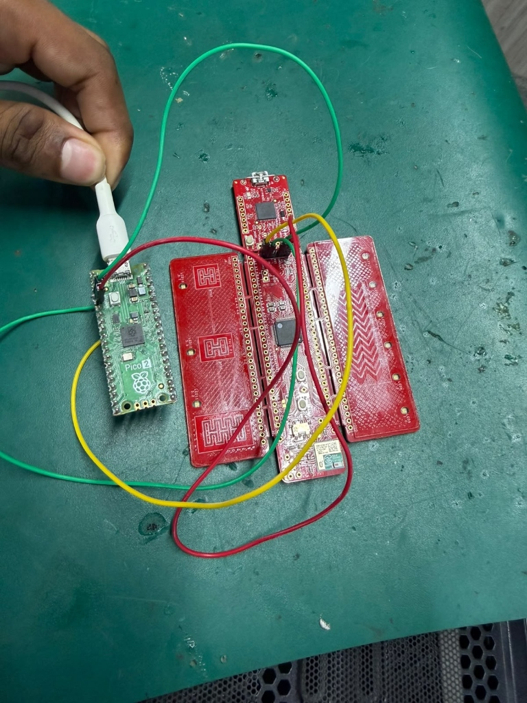
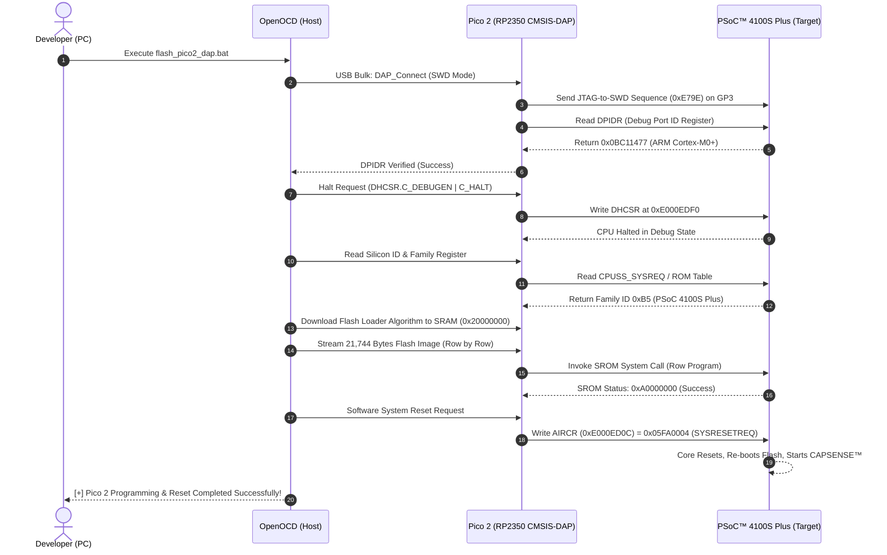

# Technical Whitepaper: RP2350 / RP2354 Architecture & CMSIS-DAP v2 SWD Probe Operation

This engineering document explains the internal silicon architecture of the **Raspberry Pi RP2350 / RP2354** microcontroller (powering the Raspberry Pi Pico 2), and details how it operates as a high-speed **hardware CMSIS-DAP v2 SWD debug probe and USB serial bridge** to flash and debug the Infineon PSoC™ 4100S Plus MCU.

---

## Table of Contents
1. [Silicon Architecture Overview](#1-silicon-architecture-overview)
2. [Dual-Core Processor Complex (ARM® Cortex®-M33 & Hazard3 RISC-V)](#2-dual-core-processor-complex)
3. [Memory & Interconnect Architecture](#3-memory--interconnect-architecture)
4. [The Core Innovation: Programmable I/O (PIO) for SWD](#4-the-core-innovation-programmable-io-pio-for-swd)
5. [Firmware Architecture: Raspberry Pi Debugprobe](#5-firmware-architecture-raspberry-pi-debugprobe)
6. [Hardware Signal Flow & Pin Routing](#6-hardware-signal-flow--pin-routing)
7. [Step-by-Step SWD Flashing & Reset Execution Flow](#7-step-by-step-swd-flashing--reset-execution-flow)
8. [Comparative Analysis: RP2350 CMSIS-DAP v2 vs ST-LINK V2 Clone](#8-comparative-analysis-rp2350-cmsis-dap-v2-vs-st-link-v2-clone)

---

## 1. Silicon Architecture Overview

The **RP2350** (and its variant **RP2354** with stacked in-package QSPI flash) is Raspberry Pi's high-performance microcontroller architecture:

```
+-----------------------------------------------------------------------------------+
|                           RP2350 / RP2354 Architecture                            |
|                                                                                   |
|  +-------------------------------------+  +------------------------------------+  |
|  |             Core Complex            |  |             Memory System          |  |
|  |  [Core 0]          [Core 1]         |  |                                    |  |
|  |  ARM Cortex-M33    ARM Cortex-M33   |  |  * 520 KB SRAM (10 Banks)          |  |
|  |  (or Hazard3       (or Hazard3      |  |  * QSPI Flash Controller (XIP)     |  |
|  |   RISC-V)           RISC-V)         |  |  * Secure Boot ROM                 |  |
|  |  @ 150 MHz         @ 150 MHz        |  |  * OTP (One-Time Programmable)     |  |
|  |  FPU / DSP         FPU / DSP        |  |                                    |  |
|  +-------------------------------------+  +------------------------------------+  |
|                                   |                                               |
|             Multi-Layer Non-Blocking AHB/AXI Bus Matrix                           |
|                                   |                                               |
|  +--------------------+  +--------------------+  +-----------------------------+  |
|  |   USB Controller   |  |   16-Channel DMA   |  |  Programmable I/O (PIO)     |  |
|  |  * Full-Speed 12Mb |  |  * Zero-CPU copy   |  |  * 3 Blocks x 4 SMs = 12 SMs|  |
|  |  * Native WinUSB   |  |  * Ring buffers    |  |  * Executes SWD protocol    |  |
|  |  * CDC-ACM (UART)  |  |  * Trigger on FIFO |  |  * Cycle-accurate timing    |  |
|  +--------------------+  +--------------------+  +-----------------------------+  |
|                                                                                   |
|  +-----------------------------------------------------------------------------+  |
|  | Peripherals: UART0/1, SPI0/1, I2C0/1, PWM, Clocks, SIO, 30/48 Multi-Drive GPIOs |
|  +-----------------------------------------------------------------------------+  |
+-----------------------------------------------------------------------------------+
```

---

## 2. Dual-Core Processor Complex

The RP2350 features a flexible heterogeneous core complex:
* **Two ARM® Cortex®-M33 Cores**:
  * Running at **150 MHz** nominal clock frequency (overclockable beyond 250 MHz).
  * Single-precision **Hardware Floating Point Unit (FPU)** conforming to IEEE 754.
  * Dedicated **DSP instruction set extensions** (SIMD, saturating arithmetic).
  * **ARM TrustZone® for Cortex-M** providing hardware-enforced secure and non-secure execution partitions.
* **Dual Hazard3 RISC-V Alternate Cores**:
  * The RP2350 boot sequence allows switching execution to two 32-bit Hazard3 RV32IMAC RISC-V cores.
* In our debug probe application, **Core 0** executes the CMSIS-DAP protocol engine and USB event loop, while **Core 1** manages UART serial buffer stream transfers.

---

## 3. Memory & Interconnect Architecture

* **520 KB Multi-Bank On-Chip SRAM**:
  * Partitioned into **10 independent memory banks**.
  * Connected via a non-blocking crossbar switch to the AHB/AXI bus matrix.
  * Allows Core 0, Core 1, the DMA engine, and the USB controller to simultaneously access memory in parallel without stalling or contention.
* **16-Channel DMA Engine**:
  * Transfers data between peripheral FIFOs (USB endpoints, UART buffers, PIO FIFOs) without consuming CPU cycles.
  * Enables high-speed continuous flash programming at line-rate bandwidth.

---

## 4. The Core Innovation: Programmable I/O (PIO) for SWD

Traditional microcontroller debuggers generate ARM Serial Wire Debug (SWD) signals via **CPU GPIO bit-banging**:
$$\text{Pin High} \rightarrow \text{Wait Delay} \rightarrow \text{Pin Low} \rightarrow \text{Sample Pin}$$

### Limitations of Software Bit-Banging:
1. **Interrupt Latency & Jitter**: If a USB or timer interrupt fires mid-transaction, SWCLK stretches unpredictably, which can corrupt sensitive target state machines.
2. **Turnaround (Trn) Collisions**: SWDIO is a single bidirectional half-duplex line. Switching pin direction from Write to Read in software takes several clock cycles, risking electrical contention.
3. **Speed Ceilings**: Software bit-banging rarely exceeds 100–400 kHz on standard microcontrollers.

### The RP2350 PIO Solution:
The RP2350 features **3 Programmable I/O (PIO) blocks**, each containing **4 independent, autonomous hardware state machines** (12 state machines total). 

In `debugprobe_on_pico2`, **PIO Block 0, State Machine 0 (`PROBE_SM 0`)** executes a dedicated microcode program that drives `SWCLK` and `SWDIO` with clock-cycle precision:

```
                  +----------------------------------------------+
                  |           ARM Cortex-M33 Core 0              |
                  +----------------------------------------------+
                                         |
                                (FIFO Write Register)
                                         ▼
+───────────────────────────────────────────────────────────────────────────────────+
│ RP2350 PIO 0 - State Machine 0 (PROBE_SM 0)                                       │
│                                                                                   │
│  [TX FIFO]  ──>  [Output Shift Register]  ──>  Pin GP2 (SWCLK, 2000 kHz)          │
│                                                     Pin GP3 (SWDIO, Out)          │
│                                                                                   │
│  [RX FIFO]  <──  [Input Shift Register]   <──  Pin GP3 (SWDIO, In)                │
+───────────────────────────────────────────────────────────────────────────────────+
                                         │
                         (Cycle-Accurate Hardware Bus)
                                         ▼
               CY8CKIT-149 PSoC™ 4100S Plus SWD Port (J4 Header)
```

1. **Jitter-Free Signal Generation**: The PIO state machine operates independently of CPU interrupts. `SWCLK` transitions occur on exact nanosecond boundaries at 2,000 kHz.
2. **Instant Turnaround Switching**: Pin direction switching between Write and Read occurs in **1 single clock cycle** inside the PIO hardware.
3. **Hardware Parity & Shift**: 32-bit packet payloads are loaded into the FIFO; the PIO automatically shifts them onto the wire, computes parity, and reads the target ACK response.

---

## 5. Firmware Architecture: Raspberry Pi Debugprobe

When flashed with [`tools/debugprobe_on_pico2.uf2`](tools/debugprobe_on_pico2.uf2), the RP2350 configures a composite USB device exposing two concurrent interfaces:

```text
USB Device Descriptor (VID: 0x2E8A, PID: 0x000C)
├── Configuration Descriptor
│   ├── Interface 0: CMSIS-DAP v2 (Vendor-Specific Class 0xFF)
│   │   ├── Endpoint 1 OUT (Bulk, 64-byte payload) -> Command Packets from OpenOCD
│   │   └── Endpoint 2 IN  (Bulk, 64-byte payload) -> Response Packets to OpenOCD
│   │
│   ├── Interface 1: Communications Device Class (CDC-ACM Header)
│   └── Interface 2: CDC Data Interface (Virtual COM Port)
│       ├── Endpoint 3 IN  (Bulk, 64-byte payload) -> Target UART TX -> PC Terminal (COM8)
│       └── Endpoint 4 OUT (Bulk, 64-byte payload) -> PC Terminal -> Target UART RX
```

* **CMSIS-DAP v2 Protocol**: Unlike CMSIS-DAP v1 (which used slow USB HID 64-byte transfer frames limited to 1 ms poll intervals), CMSIS-DAP v2 uses **USB Bulk endpoints over native Microsoft WinUSB (`WinUSB.sys`)**. This allows OpenOCD to execute multi-sector flash programming transactions at maximum USB Full-Speed bandwidth without proprietary drivers.

---

## 6. Hardware Signal Flow & Pin Routing

### Physical Test Bench Wiring
The physical hardware setup showing Raspberry Pi Pico 2 connected to the target CY8CKIT-149 J4 debug header:



```text
       Raspberry Pi Pico 2 (RP2350)                 CY8CKIT-149 J4 Debug Header
      +----------------------------+                     +---------+
      | (Pin 4)  GP2 [SWCLK]       |-------------------> |  Pin 4  | SWDCLK (Yellow wire)
      | (Pin 5)  GP3 [SWDIO]       |<------------------> |  Pin 3  | SWDIO  (Green wire)
      | (Pin 38) GND               |-------------------> |  Pin 2  | GND    (Green/Black wire)
      | (Pin 36) 3V3(OUT) [Power]  |-------------------> |  Pin 1  | VTARG  (Red wire, 3.3V)
      |                            |                     |         |
      | (Pin 6)  GP4 [UART1_TX]    |---> (Optional Target UART_RX)
      | (Pin 7)  GP5 [UART1_RX]    |<--- (Optional Target UART_TX -> COM8)
      +----------------------------+                     +---------+
```

### Signal Specifications:
* **Logic Level**: Strict 3.3V LVCMOS signaling.
* **Target Power**: Pin 36 (`3V3_OUT`) delivers regulated 3.3V power (up to 300 mA) from the Pico 2's onboard high-efficiency buck-boost regulator, directly powering the PSoC™ 4100S Plus MCU during programming.
* **Isolation**: The Micro-USB cable on the CY8CKIT-149 is disconnected, ensuring zero voltage contention between PC USB ports.

---

## 7. Step-by-Step SWD Flashing & Reset Execution Flow

When [`tools/scripts/flash_pico2_dap.bat`](tools/scripts/flash_pico2_dap.bat) is executed:



---

## 8. Comparative Analysis: RP2350 CMSIS-DAP v2 vs ST-LINK V2 Clone

| Evaluation Metric | ST-LINK V2 Clone Dongle | Raspberry Pi Pico 2 (RP2350) Debugprobe |
| :--- | :--- | :--- |
| **Microcontroller Core** | Cloned STM32F103 (Cortex-M3 @ 72 MHz, 20 KB RAM) | **RP2350 (Dual Cortex-M33 @ 150 MHz, 520 KB RAM)** |
| **USB Transport Class** | CMSIS-DAP v1 over USB HID (1 ms interrupt polling limit) | **CMSIS-DAP v2 over WinUSB Bulk Endpoints (Line-rate)** |
| **SWD Signal Generation** | Software bit-banging with timer interrupt latency | **Hardware PIO State Machines (Jitter-free)** |
| **Tested Clock Frequency** | 1,000 kHz | **2,000 kHz – 5,000+ kHz** |
| **Flashing Speed** | ~3.1 KiB/s | **6.25 KiB/s (2× faster)** |
| **Hardware Reset Line** | Clamped to 0V by STM8 SWIM pull-down circuit | **Clean 3.3V LVCMOS GPIO (No clamping bug)** |
| **Virtual COM Port** | None (programming only) | **Integrated USB CDC-ACM Serial Bridge (`COM8`)** |
| **Windows Driver Requirement** | Requires manual Zadig WinUSB INF overwrite | **Zero installation (Native Microsoft WinUSB.sys)** |
| **Open Source Ecosystem** | Proprietary / reverse-engineered ST firmware | **100% Open Source (Raspberry Pi Pico SDK & Debugprobe)** |

---

## Summary

By leveraging the **RP2350's Programmable I/O (PIO) architecture** and native **CMSIS-DAP v2 WinUSB transport**, the Raspberry Pi Pico 2 delivers an industrial-grade, deterministic, and reliable hardware programming platform for Infineon PSoC™ microcontrollers, completely eliminating the driver conflicts and hardware clamping issues inherent to low-cost legacy clones.
